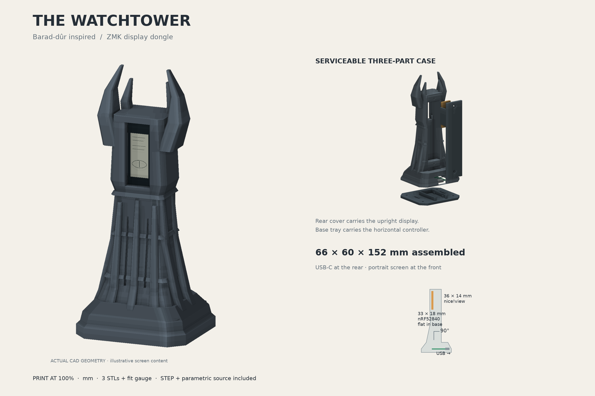

# Sauron tower display-dongle case

A Barad-dûr-inspired desk enclosure for this repository's ZMK dongle: angular
buttresses, a tapered shaft, two tall inward-curving crown talons and two shorter
rear spires. The existing firmware's animated eye appears in the portrait screen.

**Assembled size: 66 × 60 × 152 mm. All CAD/STL dimensions are millimetres.**
The nRF52840 controller lies flat in the base, parallel to the desk. The nice!view
stands vertically at **90° to the controller**, facing forward. USB-C exits the
rear at the bottom, through a cable opening centred 8 mm above the desk.



## Files to use

| File | Purpose |
| --- | --- |
| `sauron-dongle-print-pack.zip` | Complete pack: STLs, STEP files, source, instructions and previews |
| `stl/tower_shell.stl` | Main tower and base shell; print upright as exported |
| `stl/base_tray.stl` | Removable bottom, controller saddles, side guides and end stops |
| `stl/rear_cover.stl` | Removable rear panel with display support pads and lateral fences |
| `stl/display_fit_gauge.stl` | Small flat coupon to check the full display opening first |
| `cad/assembly.step` | Three enclosure parts in their assembled positions |
| `cad/assembly_with_hardware.step` | Assembly plus simplified electronics envelopes for inspection |
| `cad/*.step` | Individual editable CAD solids in assembly coordinates |
| `build_case.py` | Parametric CadQuery source, export and geometric validation |
| `validation.json` | Results of the actual CAD/mesh checks |
| `orthographic.png` | Front and rear views of the generated geometry |

The three primary STLs are already rotated and placed on the print bed. Import
them **as separate objects at 100% scale**. Their coordinates are deliberately
different from those in STEP. Do not print the assembly as one fused object.
The fit gauge is optional and is not an enclosure part.

## Verified dimensions and design allowances

The user confirmed the standard nice!view and USB-C Pro Micro nRF52840 footprints.
These dimensions come from the manufacturers' mechanical drawings, checked
2026-11-13:

| Item | Published dimensions / chosen fit |
| --- | --- |
| ProMicro nRF52840 / SuperMini PCB | **33.00 × 17.78 mm**; pin-row length 30.48 mm |
| Controller design footprint | **33 × 18 mm**, allowing for clone variation |
| Controller guide clearance | **0.40 mm per side**, **0.60 mm at each end** |
| Controller PCB underside | 6.4 mm above the desk; PCB thickness assumed 1.0 mm |
| Controller central component keepout | 2.0 mm below PCB; 3.4 mm above its assumed top |
| USB cable opening | **14 × 9 mm**, centred at Z = 8 mm; accommodates many cable mouldings |
| nice!view PCB | **36 × 14 mm**; drawing notes V-cut can add **0.1–0.2 mm** |
| nice!view section | 0.9 mm display above 1.0 mm PCB, with up to 1.0 mm rear components; **2.9 mm** overall envelope |
| Display aperture | **15.2 × 37.2 mm**; exposes the whole module, including the pin end |
| Display position | PCB long axis vertical, lower end Z = 86 mm, upper end Z = 122 mm |
| Display support | Four narrow rear edge pads, with **2 mm removable insulating foam** between pad and PCB |
| Rear panel / base floor | 2.8 mm / 3.2 mm |

Sources:

- [NOLOGO ProMicro nRF52840 documentation](https://www.nologo.tech/product/otherboard/NRF52840.html),
  especially the [manufacturer's dimension drawing](https://www.nologo.tech/assets/img/other/NRF52840/ProMicroNRF52840Size.jpg).
- [Nice Keyboards nice!view pinout and schematic](https://nicekeyboards.com/docs/nice-view/pinout-schematic/),
  especially the [manufacturer's dimension drawing](https://nicekeyboards.com/static/2f2592ff1ff8021932814b20cb76e3c4/a6d36/niceview_dimensions.png).

**Prototype status:** the generated solids and meshes have been checked digitally;
this enclosure has not been physically printed or fitted to your boards. USB
receptacle height, underside component placement and cable mouldings vary among
controller clones. The PCB thickness and controller component keepout above are
design assumptions, not dimensions supplied by NOLOGO's outline drawing. Measure
your actual hardware and use the tray and fit gauge before committing to the tower.

The display opening deliberately clears the whole module rather than overlapping
its glass. Foam goes only on suitable bare PCB edges: check the actual underside
before attaching it, and adjust pad locations in the source if necessary. Foam
thickness/compression may require adjustment to achieve the intended screen recess.
The simplified hardware STEP objects are fit envelopes, not vendor-exact models.

## Printing

- Material: matte black PLA or PETG. A dark grey dry-brush finish highlights the ribs.
- 0.4 mm nozzle, 0.16–0.20 mm layers, 4 walls, 5 top/bottom layers, 15–20% infill.
- **Tower:** upright on its base rim. Use a 5–8 mm brim. Add removable supports
  inside the open base under its roof; these can be pulled out through the bottom.
  Inspect the 15.2 mm display-window bridge in your slicer and support it if needed.
  Keep support out of the screw pilots. Crown talons taper to 1.6 mm tips.
- **Tray:** flat underside down, no supports.
- **Rear cover:** exported flat outer face down; its display supports point upward.
  No supports normally needed. Print size is approximately 25.2 × 106 × 21.5 mm.
- **Gauge:** flat as exported, no supports. Check that the module passes through
  the rectangular opening without scraping glass, PCB edges or the flex tail.
- Prefer slicer elephant-foot compensation around the mating surfaces. Remove
  burrs from pilots and seating faces; do not scale the entire model to tune fit.

There is no printer-specific G-code: slice these STLs for your machine and filament.

## Parts and assembly

You need:

- One USB-C ProMicro nRF52840 / SuperMini, approximately 33 × 18 mm.
- One standard nice!view, 36 × 14 mm.
- Five flexible hookup wires, approximately 120–150 mm each, trimmed to suit routing.
- **Six M2.5 × 8 mm low-profile button-head screws**: four for the base and two
  for the rear panel. Head diameter must be ≤ 4.8 mm and head height ≤ 1.7 mm.
  These thread directly into printed 2.1 mm pilots; no heat-set inserts are required.
- Removable insulating foam/tape: 2 mm thick for the display support pads, and
  small thin pieces for securing the controller to its plastic saddles.
- Optional rubber feet beneath the base.

The five display connections, matching the repository README:

| nice!view | ProMicro nRF52840 / nice!nano v2 |
| --- | --- |
| MOSI | P0.17 (D2) |
| SCK | P0.20 (D3) |
| CS | P0.06 (D1) |
| VCC | VCC (3.3 V) |
| GND | GND |

1. **Test the footprints.** Print the base tray and display fit gauge first. Confirm
   the actual controller, its solder joints and USB cable can sit in the tray.
   This design uses directly soldered wires, without tall pin headers, an adapter
   PCB, battery or a stacked controller/display assembly.
2. Wire the display using the wiring table above.
   With display pins at the lower end, leave enough service loop to pull the rear
   panel away without tugging on the solder joints. Check the portrait image before
   fixing the display in place; if your firmware orientation differs, adjust that
   orientation before assembly.
3. Seat the controller **component side upward**, with USB-C pointing rearward
   (+Y). Four plastic edge saddles support its underside at Z = 6.4 mm; side
   guides and split end stops locate it. Use small pieces of removable tape at
   suitable bare edges to prevent lifting. Keep underside solder and components
   clear of the saddles. Do not rely on the USB connector to retain the board.
4. Attach the nice!view's **bare rear PCB edges** to the four narrow support pads
   on the inside of the rear cover, using 2 mm insulating foam. Pad centres are
   X = ±6.2 mm and Z = 95/113 mm in assembly coordinates. Align its lower PCB edge
   at Z = 86 mm. The two side fences leave 0.3 mm clearance per side. Apply no
   clamping force or adhesive to the glass, flex tail or populated components.
5. Route the five wires up the front of the hollow shaft. The rear screw crossbars
   occupy Y = +2 to +10 mm; the passage in front of them remains open. Keep a
   service loop in the base and avoid pinching it under the rear panel.
6. Fit the rear panel, keeping the display clear of the front opening. Install its
   two M2.5 × 8 mm screws from the rear. Start screws gently by hand into the
   printed pilots and stop when seated.
7. Close the base with the tray and four M2.5 × 8 mm screws from underneath.
   Test USB insertion and removal, Bluetooth reception, screen visibility and
   bootloader entry. Remove the tray for physical reset access; the large rear
   panel gives solder/wiring access. No clone-specific reset-button hole is assumed.

## Editing and rebuilding

Use Python 3.13 and the pinned dependencies in a virtual environment:

```sh
python3 -m venv /tmp/sauron-cad
/tmp/sauron-cad/bin/python -m pip install -r hardware/sauron-dongle/requirements.txt
/tmp/sauron-cad/bin/python hardware/sauron-dongle/build_case.py
/tmp/sauron-cad/bin/python hardware/sauron-dongle/render_preview.py
```

The main adjustable values are at the top of `build_case.py`: controller width and
length, PCB seating height, USB opening size/height, display dimensions, display
support foam thickness, and screw pilot size. The tower exterior is intentionally
fixed; larger hardware changes also require reviewing its pockets and braces.
Run the geometric checks again after edits. Rebuilding replaces generated CAD,
STLs, previews and the validation report; re-run `package.py` for an updated ZIP.

The builder checks CAD validity, one connected solid per print part, watertight and
consistently wound STL meshes, part-to-part interference, electronics keepouts and
the rear USB cable corridor. `validation.json` records the measured results.
These checks establish digital geometry integrity, not printer tolerances,
mechanical durability or a physically tested fit.
